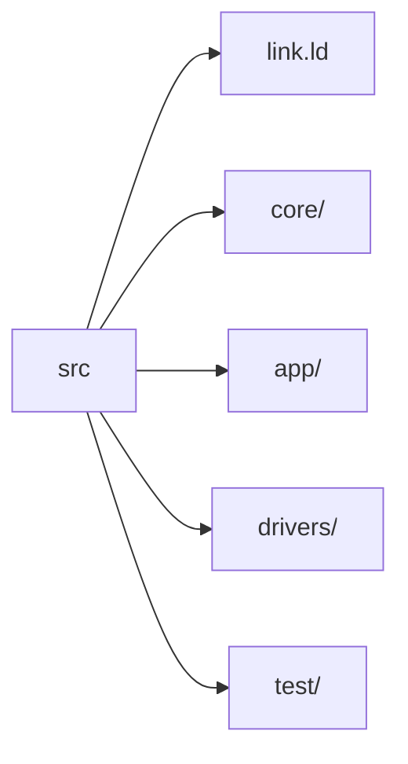
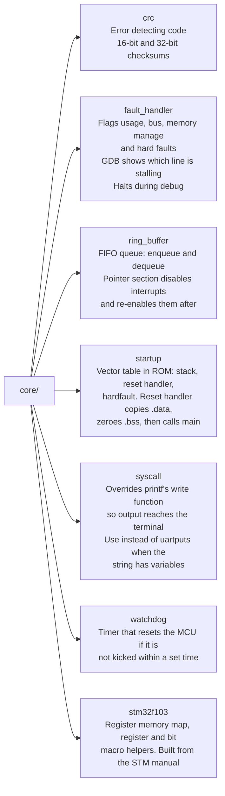
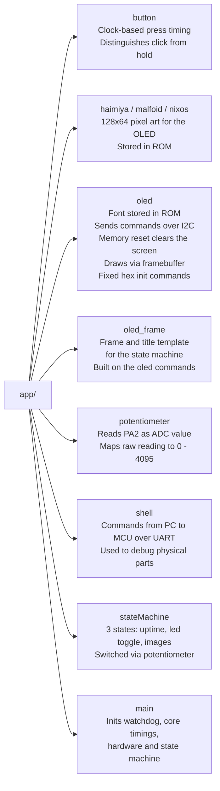
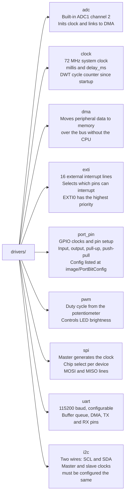
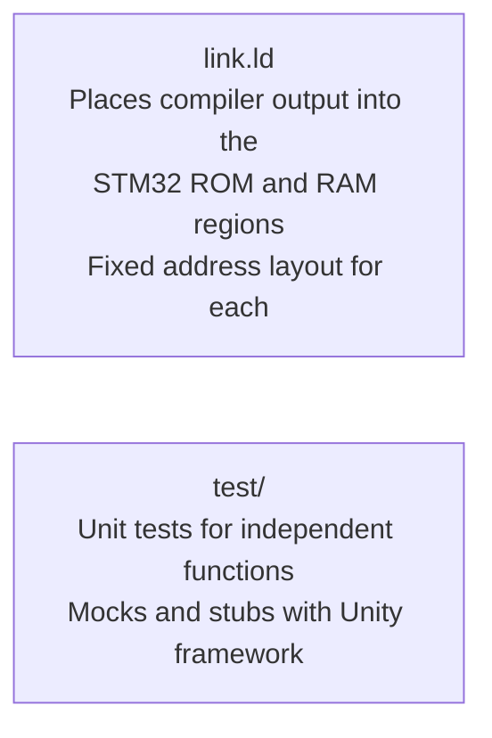
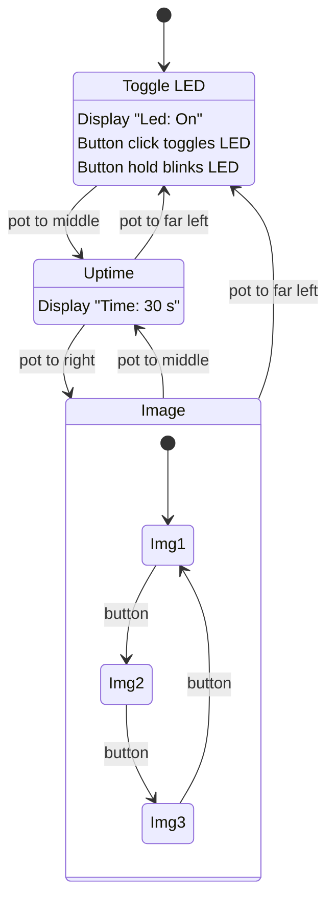

# Architecture

STM32F103C6T6 (Blue Pill) firmware. Layered so that `app/` depends on `drivers/`, and `drivers/` and `app/` depend on `core/`.

## Folder Structure

## core/

## app/

## drivers/

## link.ld and test/

## State Machine
- Far left: Toggle LED
- Middle: Uptime
- Far right: Image

