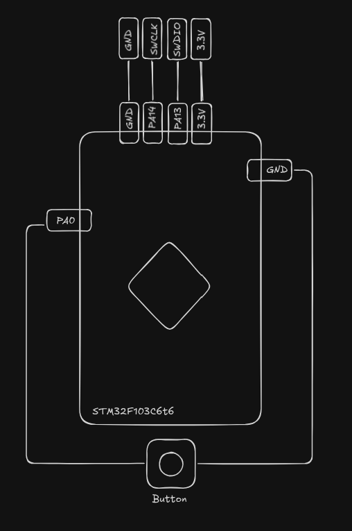

This repo is meant to enhance my embedded skills in preparation for my career goals. The project uses STM32F103C6T6 and scoped to be accomplish within 30 days. This was build from m3y54m Embedded Engineering Roadmap trimmed to the software side of C, microcontrollers, protocols, RTOS, debugging, build systems and embedded Linux

# Part List 
- STM32F103C6T6
- ST-Link V2 dongle
- USB-to-TTL adapter, CH340G module
- 830-point breadboard
- 0.96 inch SSD1306 OLED 
- 10 tactile switches, 12 mm 
- B10k potentiometer (WH148)

Each day has a project to commit to this repo with its own documentation and change to the src folder

# Overview of Daily Task 
- Learn (2h)
- Build (4h)
- Debug and Test (1.5h)
- Write-up (1h)

# Daily Documentation 
I make a documentation of my learnings per day and they are all made through excalidraw so to access them. Open them with excalidraw to properly see the documentation 

# Branch Experiments
## Creating a Reaction Game 

Branch: `Day7-Reaction-Time-Game`

### Objecting
- Create a state machine with IDLE, WAIT_RANDOM, GO, RESULT, and TOO_EARLY
- In IDLE, a button press starts a random 1–3 s wait (a simple LFSR seeded from the SysTick count at the first press). In GO, light the LED and start timing. A press stops the timer; blink the reaction time in tens of ms. An early press goes to TOO_EARLY.
### Wiring Diagram


### GIF


### Implementation of the state machine 
- It was first created in excalidraw by drawing the flow from one state to another then created a table with state, event, next_state, and action
- As for code implementation, it is done via switch-case where it checks on the state case then does the operation and moves to the next state 
- The test timing of this code was done *in le head* 
# Reference
- Test Driven Development: https://pragprog.com/titles/jgade/test-driven-development-for-embedded-c/

## To Compile
```
make
```

## To Flash to board
```
openocd -f interface/stlink.cfg -f target/stm32f1x.cfg -c 'program app.elf verify reset exit'
```
