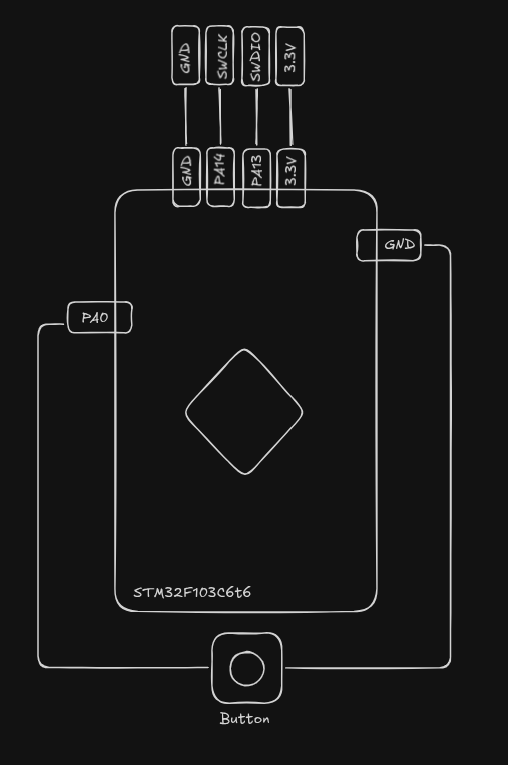
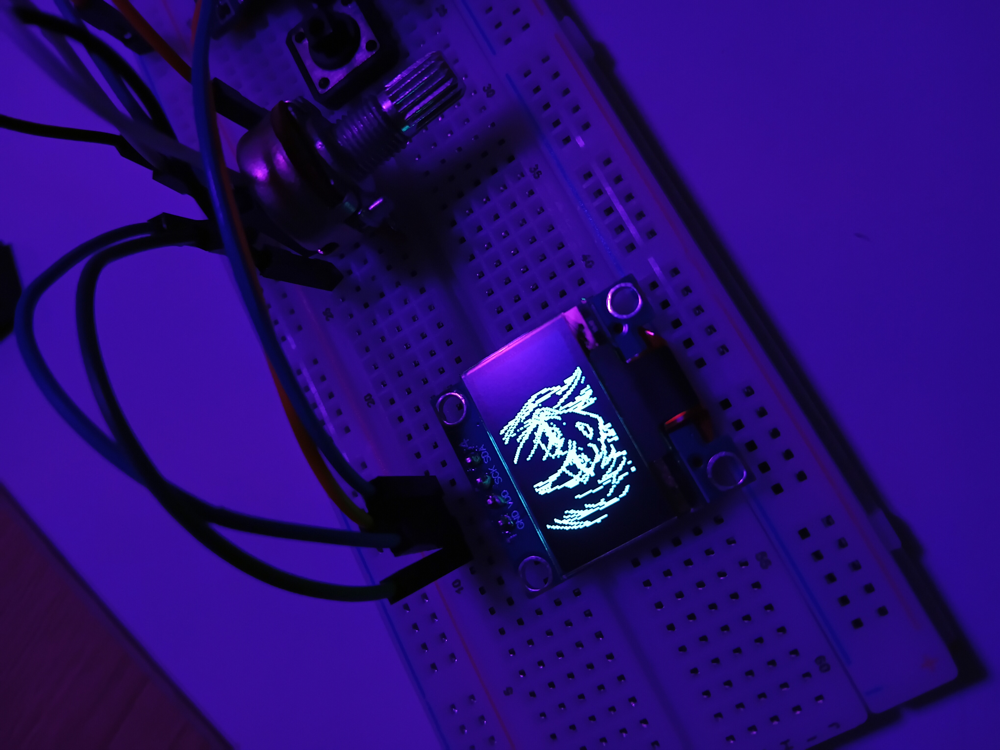

This repo is meant to enhance my embedded skills in preparation for my career goals. The project uses STM32F103C6T6 and scoped to be accomplish within 30 days. This was build from m3y54m Embedded Engineering Roadmap trimmed to the software side of C, microcontrollers, protocols, RTOS, debugging, build systems and embedded Linux

[](https://github.com/PJ-Caleon/stm32-firmware-lab/actions/workflows/ci.yml)

# Part List 
- STM32F103C6T6
- ST-Link V2 dongle
- USB-to-TTL adapter, CH340G module
- 830-point breadboard
- 0.96 inch SSD1306 OLED 
- 10 tactile switches, 12 mm 
- B10k potentiometer (WH148)

Each day has a project to commit to this repo with its own documentation and change to the src folder

# Overview of Daily Task 
- Learn
- Build
- Debug and Test 
- Write-up

# Daily Documentation 
I make a documentation of my learnings per day and they are all made through excalidraw so to access them. Open them with excalidraw to properly see the documentation 

# Branch Experiments
## Creating a Reaction Game 

Branch: `Day7-Reaction-Time-Game`

### Objecting
- Create a state machine with IDLE, WAIT_RANDOM, GO, RESULT, and TOO_EARLY
- In IDLE, a button press starts a random 1–3 s wait (a simple LFSR seeded from the SysTick count at the first press). In GO, light the LED and start timing. A press stops the timer; blink the reaction time in tens of ms. An early press goes to TOO_EARLY.
### Wiring Diagram


### GIF


### Implementation of the state machine 
- It was first created in excalidraw by drawing the flow from one state to another then created a table with state, event, next_state, and action
- As for code implementation, it is done via switch-case where it checks on the state case then does the operation and moves to the next state 
- The test timing of this code was done *in le head* 
## Yunayuispink's Malfoid in OLED

Branch: `day11-I2C`

During the implementation of the I2C with OLED, I decided to add this cool artwork just for fun. Original artwork goes to `@yunayuispink`



## Event Driven Programming

Branch: `day16-embedded-design-pattern`

Enhanced the state machine UI
- Sliding window function
- led toggle, uptimer counter, image index
- Using the ring buffer for efficiency

[](https://www.instagram.com/reel/DfMv-hFpHJA/)

# Memory Budget Table
## Expected Memory

```
❯ arm-none-eabi-size app.elf
   text	  data	   bss	   dec	   hex	filename
  25301	    96	  3040	 28437	  6f15	app.elf
```
## Actual Memory

```
✿ ~ ❯  ram
.data: 96 bytes
.bss: 2016 bytes
Free Ram: 8224 bytes
Peak Stack: 644 out of 1024 bytes
```

# Reference
- Test Driven Development: https://pragprog.com/titles/jgade/test-driven-development-for-embedded-c/

## To Compile
- Do this both inside the directory of `bootloader/` and `src/`
```
make clean && make
```

## To Flash to board
```
openocd -f interface/stlink.cfg -f target/stm32f1x.cfg -c 'program app.elf verify reset exit'
```

## To Flash to board with bootloader
Implemented at `day22-bootloader`
```
openocd -f interface/stlink.cfg -f target/stm32f1x.cfg \
        -c "init" \
        -c "reset init" \
        -c "flash write_image erase bootloader/bootloader.elf" \
        -c "flash write_image erase src/app_meta.bin 0x08001000 bin" \
        -c "flash write_image erase src/app.bin 0x08001400 bin" \
        -c "reset run" \
        -c "shutdown"
```

## To Debug
```
picocom -b 115200 /dev/ttyUSB0
```

## To Test
```
make test
```

## GDB Debug
- Terminal 1
```
openocd -f interface/stlink.cfg -f target/stm32f1x.cfg
```

- Terminal 2
```
arm-none-eabi-gdb build/bootloader.elf
```
- In GDB
```
target remoted-extended :3333
symbol-file bootloader/bootloader.elf

```